  

 

### ABOUT

Hi, I'm Denys – a full-stack developer in Oslo, by way of Ukraine and Slovakia.
I'm an IT developer apprentice at Comono, where most of my days go into drone ground-control software.
I like owning the whole path, from the database row to the button someone finally taps – and the moment an idea turns into a link you can open.

 

### THINGS I HAVE BUILT AND SHIPPED

 

### STACK

 

### OFF THE KEYBOARD

Certified drone pilot – if the wind is calm, the drone is already in my bag.
Gym every other day, PADI diver in summer, snowboard the day the slopes open, padel with anyone willing to lose to me.
Red Cross volunteer. Dota 2 and Rust with friends in the evenings.

 

### ACTIVITY

  

 

<picture>
  <source media="(prefers-color-scheme: dark)" srcset="https://raw.githubusercontent.com/KovalDenys1/KovalDenys1/output/github-snake-dark.svg" />
  <source media="(prefers-color-scheme: light)" srcset="https://raw.githubusercontent.com/KovalDenys1/KovalDenys1/output/github-snake.svg" />
  
</picture>

 

  <i>Made with care, not noise – Oslo, Norway.</i>

